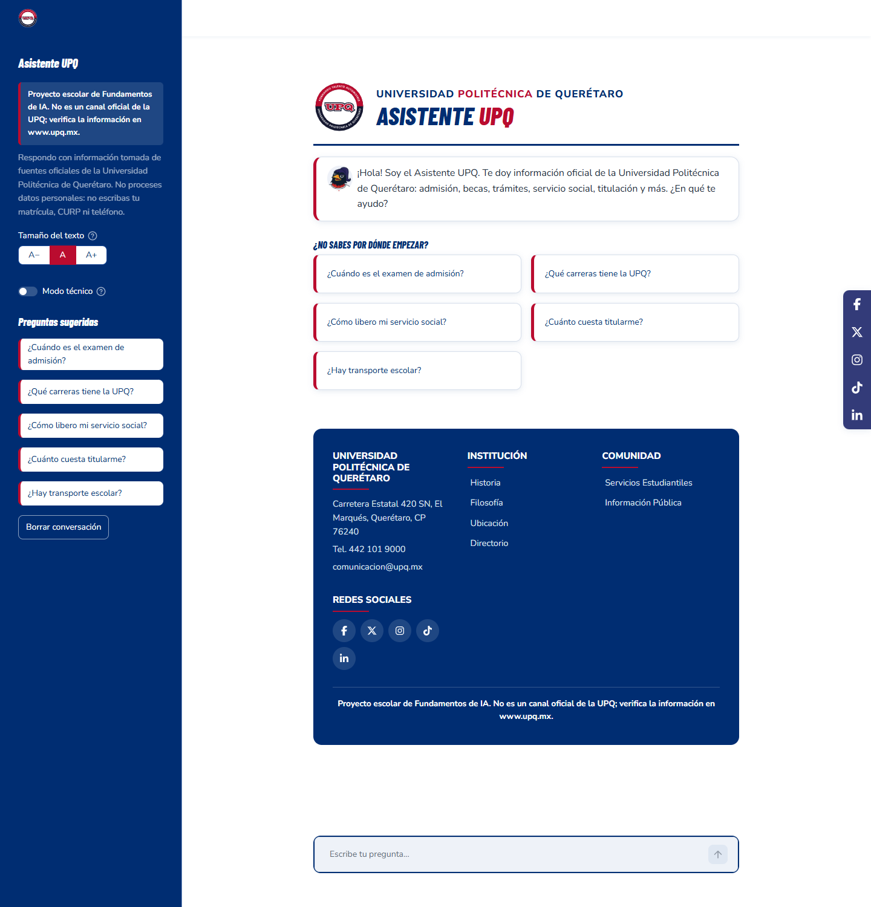
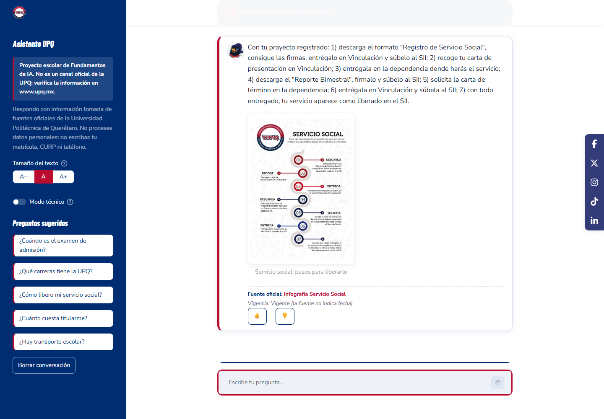

# Asistente UPQ

Plataforma de asistencia informativa para la Universidad Politécnica de Querétaro, construida con
**aprendizaje supervisado** (TF-IDF + scikit-learn). Se ejecuta 100 % en local, sin APIs externas.

> Proyecto de la **Tarea Especial 2/2** (Fundamentos de IA). Entrega: **1 de diciembre, 11:00 a.m.**

## Integrantes
- Ricardo Sebastián Balderas González (Baz)
- Fernanda Juárez García

## Qué lo hace más que un chatbot

- **Cero alucinaciones por diseño:** el sistema no genera texto; recupera información oficial y la cita con su fuente.
- **Auditable:** cada respuesta indica intención, confianza, fragmento usado y origen (modelo, caché, fallback o guardrail).
- **Seguro:** guardrails de entrada y salida; no procesa ni registra datos personales.
- **Mejora continua:** la retroalimentación de los usuarios alimenta el corpus y el reentrenamiento versionado.
- **Observable:** panel técnico con intenciones más consultadas, tasa de fallback, aciertos de caché y latencia.

## Flujo de una consulta

```
Entrada del usuario
   │
   ▼
[Guardrails de entrada] ── rechazada ──► mensaje seguro (origen: guardrail)
   │
   ▼
[Caché] ── acierto ──► respuesta guardada (origen: cache)
   │
   ▼
[Router = clasificador supervisado]  → intención + confianza + top-3
   │
   ├─ confianza alta ──► [Recuperador de fragmentos] → [Herramientas, si la intención lo pide]
   │                         │
   │                         ▼
   │                  [Guardrails de salida] → respuesta + fuente (origen: modelo)
   ├─ confianza media ─► "¿Quisiste decir…?" con las 3 mejores intenciones
   └─ confianza baja ──► fallback con datos de contacto (origen: fallback)
   │
   ▼
[Registro sin datos personales] → analítica y retroalimentación
```

`app.py` se mantiene delgado (carga, recibe input, llama a `ChatbotUPQ.responder()` y muestra);
toda la lógica vive en `src/`.

## Cumplimiento de la tarea

| Requisito de la tarea | Dónde está |
|---|---|
| Corpus CSV (≥10-15 intenciones, ≥20 variantes) | `data/corpus_upq.csv` (columnas `texto,intencion,respuesta,fuente`) |
| Vectorización TF-IDF | `src/entrenamiento.py`, `models/vectorizador.pkl` |
| ≥2 algoritmos con mismo procedimiento, F1 y matriz de confusión | `notebooks/ciclo_de_vida_modelo.ipynb` |
| Evaluación de rendimiento | notebook + `docs/` (matrices y curva de umbral) |
| Interfaz de chat con fallback por umbral | `app.py`, `src/chatbot.py`, `models/config.json` |
| `requirements.txt` y README paso a paso | este archivo y `requirements.txt` |
| Modelos entrenados | `models/modelo.pkl`, `models/vectorizador.pkl` |

## Interfaz



La interfaz (`app.py`, Streamlit) sigue la identidad visual de [upq.mx](https://www.upq.mx):

- **Colores** tomados de la hoja de estilos del sitio: azul `#002D72` y rojo `#BA0C2F` (`.streamlit/config.toml`).
- **Tipografías** de Google Fonts: Nunito Sans (la misma del sitio) para el texto y Barlow Condensed
  ExtraBold itálica para los títulos.
- **Encabezado** con el logo y "UNIVERSIDAD **POLITÉCNICA** DE QUERÉTARO", barra flotante de redes
  y pie de página con contacto, enlaces oficiales y redes.
- **Cada respuesta** muestra la imagen del fragmento (si la tiene), la fuente oficial como enlace y su vigencia.
- **Preguntas sugeridas** como tarjetas, control de tamaño de texto, modo técnico y 👍/👎.
- Los estilos viven en `assets/estilos.css`; los íconos de redes son de Font Awesome Free (CC BY 4.0),
  guardados en `assets/img/redes/` para que funcionen sin internet.

> **Aviso:** proyecto escolar de Fundamentos de IA. No es un canal oficial de la UPQ; la interfaz lo
> indica en el sidebar y en el pie de página.

| Respuesta con imagen y fuente | Celular |
|---|---|
|  |  |

## Estructura

```
config/asistente.json        personalidad, mensajes y reglas del asistente (equivale al "prompt")
data/intenciones/            corpus por responsable (corpus_baz.csv, corpus_fernanda.csv)
data/corpus_upq.csv          corpus final (generado por scripts/unir_corpus.py)
data/fragmentos/             fragmentos oficiales para el recuperador (Plus A)
data/fuera_de_alcance.csv    preguntas fuera de dominio (calibración del umbral)
data/prueba_humana.csv       preguntas escritas por compañeros, solo para evaluar
models/                      modelo.pkl, vectorizador.pkl, config.json (umbrales)
notebooks/                   ciclo de vida del modelo
src/                         preprocesamiento, entrenamiento, router, guardrails, recuperador, cache,
                             herramientas, registro, chatbot (orquestador)
scripts/                     unir_corpus.py, reentrenar_desde_feedback.py, resumen_logs.py
tests/                       pruebas con pytest
docs/                        imágenes de métricas y documentación
app.py                       interfaz Streamlit
.streamlit/config.toml       tema con los colores institucionales
assets/                      estilos.css, logo, mascota, íconos de redes e imágenes de los fragmentos
```

## Instalación y ejecución _(se completa y se verifica desde un clon limpio el 28 de nov.)_

```bash
python -m venv .venv
source .venv/bin/activate        # Windows: .venv\Scripts\activate
pip install -r requirements.txt
python -m src.entrenamiento      # genera models/*.pkl
streamlit run app.py
```

## Contrato entre módulos

`ChatbotUPQ.responder(texto) -> dict` con: `intencion`, `confianza`, `respuesta`, `fuente`,
`es_fallback`, `top3`, `origen` (`guardrail` | `cache` | `modelo` | `fallback`), `latencia_ms`.

| Módulo | Función pública |
|---|---|
| `preprocesamiento` | `limpiar_texto(texto) -> str` |
| `router` | `predecir(texto_limpio) -> {"intencion", "confianza", "top3"}` |
| `guardrails` | `validar_entrada(texto) -> (ok, texto, motivo)` · `validar_salida(respuesta) -> bool` |
| `recuperador` | `buscar(texto, intencion, k=1) -> list[Fragmento]` |
| `cache` | `Cache.get(clave)` · `Cache.set(clave, valor)` · `Cache.metricas()` |
| `herramientas` | `ejecutar(nombre, **args) -> str` |
| `registro` | `registrar(evento: dict)` (sin datos personales) |

Si el contrato cambia, lo modifica el dueño del módulo y avisa por chat antes de subirlo.

## Reparto de trabajo

Nadie depende del otro: el día 0 se suben **stubs** de todos los módulos y un modelo entrenado con
datos semilla, y cada quien trabaja contra el contrato.

### Baz: datos, modelo, seguridad y mejora continua
| Entregable | Archivos |
|---|---|
| Preprocesamiento (minúsculas, acentos, signos, n-gramas) | `src/preprocesamiento.py` |
| Entrenamiento, comparativa de 4 modelos con validación cruzada, F1 macro, matrices, análisis de errores | `src/entrenamiento.py`, `notebooks/ciclo_de_vida_modelo.ipynb` |
| Router (carga del modelo, probabilidades, umbrales calibrados) | `src/router.py`, `models/*` |
| Guardrails de entrada y salida (largo, groserías, datos personales) | `src/guardrails.py` |
| Registro sin datos personales y bucle de retroalimentación | `src/registro.py`, `scripts/reentrenar_desde_feedback.py`, `scripts/resumen_logs.py` |
| Corpus bloque A + saludo, despedida, agradecimiento + fuera de alcance + prueba humana | `data/intenciones/corpus_baz.csv`, `data/fuera_de_alcance.csv`, `data/prueba_humana.csv` |
| Tests del modelo y los guardrails | `tests/test_preprocesamiento.py`, `test_entrenamiento.py`, `test_guardrails.py` |

### Fernanda: producto, recuperación e interfaz
| Entregable | Archivos |
|---|---|
| Orquestador (flujo completo y 3 niveles de fallback) | `src/chatbot.py` |
| Interfaz de chat, preguntas sugeridas, modo técnico, 👍/👎 | `app.py` |
| Recuperador de fragmentos TF-IDF dentro de la intención | `src/recuperador.py`, `data/fragmentos/` |
| Herramientas deterministas (calendario, contacto, enlaces oficiales) | `src/herramientas.py` |
| Caché LRU con métrica de aciertos | `src/cache.py` |
| Configuración del asistente (personalidad y mensajes) | `config/asistente.json` |
| Corpus bloque B | `data/intenciones/corpus_fernanda.csv` |
| Tests del orquestador, caché y herramientas | `tests/test_chatbot.py`, `test_cache.py`, `test_herramientas.py` |
| Instalación y ejecución verificadas desde cero | `README.md` (esta sección) |

### Compartido
- `scripts/unir_corpus.py` (Baz lo escribe, Fernanda lo revisa).
- Revisión cruzada por PR del corpus del otro (miércoles 25).
- En la defensa, **cada quien explica también la parte del otro**.

## Intenciones

**Bloque A (Baz):** `admision`, `oferta_educativa`, `costos_pagos`, `becas`, `calendario_escolar`,
`reinscripcion`, `estadias`, más `saludo`, `despedida`, `agradecimiento`.

**Bloque B (Fernanda):** `servicio_social`, `titulacion`, `ingles_idiomas`, `movilidad_intercambio`,
`servicios_escolares`, `ubicacion_transporte`, `contacto_horarios`, `biblioteca_actividades`.

Mínimo 20 variantes por intención (meta 25), con estilos distintos: formal, coloquial, con y sin acentos,
con faltas comunes. Toda intención lleva `fuente` oficial; no se inventan costos ni fechas.

## Roadmap

El proyecto se construye por niveles. Un nivel no empieza hasta que el anterior funciona de punta a punta.

| Nivel | Contenido | Prioridad |
|---|---|---|
| **Núcleo** | Corpus, TF-IDF, comparativa de modelos con CV, matrices, chat con fallback, README, notebook, `.pkl` | Obligatorio (asegura la rúbrica) |
| **Plus A** | Guardrails, recuperador de fragmentos, herramientas, modo técnico, conjunto humano, curva de umbral | Diferenciador |
| **Plus B** | Caché, bucle de retroalimentación, panel de métricas, CI con pytest | Solo si sobra tiempo |
| **Plus C (condicional)** | LLM local como capa opcional de redacción | **Solo con autorización escrita del profesor** |

| Fechas | Baz | Fernanda |
|---|---|---|
| **Vie 20** | Sube contrato, stubs y modelo semilla | Clona, crea entorno, revisa contrato |
| **Sáb 21 – Lun 23** | Corpus A, preprocesamiento, pipeline base, router | Corpus B, orquestador, interfaz básica |
| **Mar 24 (compuerta)** | Núcleo funcionando de punta a punta. Si no, se congela el Plus | Ídem |
| **Mié 25 – Vie 27** | Comparativa completa, análisis de errores, umbral calibrado, guardrails, prueba humana | Recuperador, herramientas, fallback en 3 niveles, modo técnico, pruebas con compañeros |
| **Sáb 28 – Dom 29** | Reentrena con corpus final, notebook ejecutado, `.pkl` definitivos | README final, verificación desde un clon limpio |
| **Lun 30** | Ensayo de defensa (cada quien explica la parte del otro) | Ídem |
| **Mar 1, antes de 11:00** | Un integrante entrega el link en Classroom (repo con permiso de lectura, integrantes mencionados) | |

## Flujo de Git

- `main` recibe cambios por Pull Request con Squash and merge; no se exige aprobación y cada quien mergea lo suyo.
- Ramas `baz/<tema>` y `fernanda/<tema>`; PRs pequeños y frecuentes.
- `git pull` de `main` antes de empezar cada sesión.
- Cada quien edita únicamente sus archivos (tablas de arriba).

## Convención de commits

`[Tipo] Descripción en español, en presente`

| Prefijo | Uso |
|---|---|
| `[New]` | Funcionalidad nueva |
| `[Update]` | Mejora de algo existente |
| `[Fix]` | Corrección de errores |
| `[Data]` | Cambios al corpus |
| `[Refactor]` | Reestructura sin cambiar comportamiento |
| `[Docs]` | README, docstrings, notebook |
| `[Test]` | Pruebas |
| `[Chore]` | Configuración y dependencias |

Ejemplos: `[Data] Agrega 25 variantes de la intención becas` · `[New] Agrega guardrails de entrada`