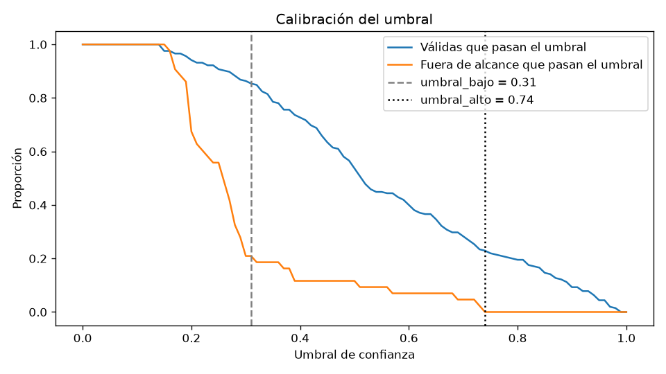
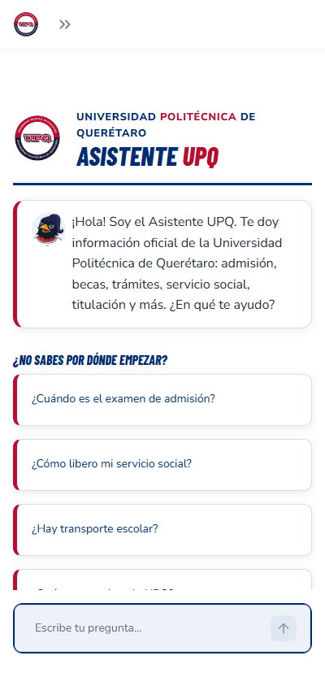

# Asistente UPQ

Plataforma de asistencia informativa para la Universidad Politécnica de Querétaro, construida con
**aprendizaje supervisado** (TF-IDF + scikit-learn). Se ejecuta 100 % en local, sin APIs externas.

> Proyecto de la **Tarea Especial 2/2** (Fundamentos de IA). Entrega: **1 de diciembre, 11:00 a.m.**

## Integrantes
- Ricardo Sebastián Balderas González (Baz)
- Fernanda Juárez García

## Resultados en números

| Qué | Resultado |
|---|---|
| Corpus | **390 frases** en **18 intenciones** (de 20 a 25 por intención), cada intención con una respuesta oficial y su fuente |
| Modelo elegido | Regresión Logística (`C=10`) sobre TF-IDF de n-gramas de caracteres |
| F1 macro (validación cruzada, 5 folds) | **0.801 ± 0.043** (accuracy 0.803) |
| Umbrales calibrados | `umbral_alto` = **0.58**, `umbral_bajo` = **0.26** (`models/config.json`) |
| Respuestas directas (validación cruzada) | **41 %** de las preguntas, con **97 %** de acierto |
| Preguntas ajenas rechazadas (calibración) | **79 %** de las que llegan al modelo |
| Prueba adversarial (41 preguntas, no usadas para entrenar) | respuestas directas **100 %** correctas; en "¿Quisiste decir…?" la correcta está en el top-3 el **100 %**; guardrails 4 de 4 |
| Pruebas automáticas | **78** pruebas con pytest |

## Qué lo hace más que un chatbot

- **Cero alucinaciones por diseño:** el sistema no genera texto; recupera información oficial y la cita con su fuente.
- **Auditable:** cada respuesta indica intención, confianza, fragmento usado y origen (modelo, caché, fallback o guardrail).
- **Seguro:** antes del modelo se rechazan datos personales (correo, teléfono, CURP, tarjeta), lenguaje ofensivo,
  intentos de manipulación y preguntas sobre otras instituciones; el registro no guarda datos personales.
- **Sabe decir "no sé":** con confianza media pregunta "¿Quisiste decir…?" con las 3 opciones más probables, y con
  confianza baja da los datos de contacto en lugar de adivinar.
- **Retroalimentación registrada:** los 👍/👎 se guardan sin datos personales en `logs/consultas.jsonl` para
  revisar qué preguntas fallan y agregarlas como variantes; el reentrenamiento es manual y reproducible (ver abajo).
- **Transparente:** el modo técnico muestra en cada respuesta la intención, la confianza, el top-3, el origen y la
  latencia, además de los aciertos de la caché.

## Flujo de una consulta

```
Entrada del usuario
   │
   ▼
[Guardrails de entrada] ── rechazada ──► mensaje seguro (origen: guardrail)
   │
   ▼
[Caché] ── acierto ──► respuesta guardada (origen: cache)
   │
   ▼
[Router = clasificador supervisado]  → intención + confianza + top-3
   │
   ├─ confianza alta ──► [Recuperador de fragmentos] → [Herramientas, si la intención lo pide]
   │                         │
   │                         ▼
   │                  [Guardrails de salida] → respuesta + fuente (origen: modelo)
   ├─ confianza media ─► "¿Quisiste decir…?" con las 3 mejores intenciones
   └─ confianza baja ──► fallback con datos de contacto (origen: fallback)
   │
   ▼
[Registro sin datos personales] → analítica y retroalimentación
```

`app.py` se mantiene delgado (carga, recibe input, llama a `ChatbotUPQ.responder()` y muestra);
toda la lógica vive en `src/`.

## Cómo se construyó el modelo

### Datos
- **Corpus:** cada integrante edita su archivo en `data/intenciones/` (`corpus_baz.csv`, `corpus_fernanda.csv`) con las
  columnas `texto, intencion, respuesta, fuente`. `scripts/unir_corpus.py` los une en `data/corpus_upq.csv`, quita
  duplicados después de limpiar el texto y **falla con código 1** si una misma frase aparece con dos intenciones.
- **Fuentes oficiales:** las respuestas salen de documentos de upq.mx y queretaro.gob.mx. `docs/INVENTARIO_FUENTES.md`
  lista las fuentes usadas, las descartadas, las contradicciones encontradas y los datos pendientes. Los PDF originales
  no se suben al repo (`docs/fuentes/` está en `.gitignore`). Los costos se expresan en UMA y en pesos con la UMA 2026.
- **Fragmentos:** `data/fragmentos/fragmentos_upq.csv` tiene 129 fragmentos oficiales de 15 intenciones (95 con imagen)
  que el recuperador busca dentro de la intención predicha.

### Preprocesamiento y vectorización
- `limpiar_texto` (`src/preprocesamiento.py`): minúsculas, sin acentos (normalización NFD), sin signos y sin espacios de sobra.
- `TfidfVectorizer(analyzer="char_wb", ngram_range=(3, 5), sublinear_tf=True)`: los n-gramas de **caracteres** toleran
  faltas de ortografía y abreviaturas ("veca" comparte "eca" con "beca"), algo frecuente en cómo escriben los alumnos.

### Comparativa y elección (`notebooks/ciclo_de_vida_modelo.ipynb`)
Los cinco modelos se evaluaron con el mismo `Pipeline` y los mismos 5 folds (`StratifiedKFold`, `random_state=42`).
El TF-IDF se ajusta solo con el entrenamiento de cada fold, para evitar fuga de datos.

| Modelo | F1 macro ± desv. | Accuracy |
|---|---|---|
| **LogisticRegression (C=10)** | **0.801 ± 0.043** | 0.803 |
| LinearSVC | 0.791 ± 0.048 | 0.795 |
| LogisticRegression (C=1) | 0.759 ± 0.049 | 0.769 |
| MultinomialNB | 0.721 ± 0.032 | 0.738 |
| KNN (coseno, k=3) | 0.607 ± 0.015 | 0.613 |

Se eligió **Regresión Logística con C=10**: obtiene el mejor F1 macro y, aunque LinearSVC queda a menos de una
desviación estándar, la regresión logística da probabilidades nativas (`predict_proba`), que el fallback por umbral
necesita, sin una calibración adicional. C=10 supera a C=1 por 0.042, casi una desviación estándar.

### Calibración del umbral (`scripts/calibrar_umbrales.py`)
Con validación cruzada sobre el corpus y con `data/fuera_de_alcance.csv` (preguntas ajenas a la UPQ que nunca se
usan para entrenar):
- `umbral_bajo` se fija para rechazar el 80 % de las preguntas ajenas que pasan los guardrails.
- `umbral_alto` es el valor más bajo con al menos 95 % de acierto, al menos 5 casos y ninguna pregunta ajena por encima.



| Zona | Qué hace | Validación cruzada |
|---|---|---|
| confianza ≥ 0.58 | responde directo | 41 % de las preguntas, 97 % de acierto |
| 0.26 ≤ confianza < 0.58 | "¿Quisiste decir…?" con el top-3 | 40 % |
| confianza < 0.26 | fallback con datos de contacto | 19 % de las válidas; rechaza el 79 % de las ajenas |

### Guardrails (`src/guardrails.py`)
Reglas fijas antes del modelo, porque estos casos son patrones exactos que no necesitan entrenamiento: entrada vacía o
de más de 300 caracteres, datos personales (correo, teléfono, CURP, tarjeta), lenguaje ofensivo, intentos de
manipulación ("ignora tus instrucciones", "actúa como…") y menciones de otras universidades o de educación básica,
que el clasificador confundiría con preguntas válidas. A la salida, se rechaza cualquier respuesta vacía o marcada
como no verificada (`[PENDIENTE]`).

### Reentrenar después de cambiar el corpus
El modelo es una foto del corpus; si el corpus cambia, se repite la cadena completa en este orden:

```bash
python scripts/unir_corpus.py        # une y valida el corpus
python -m src.entrenamiento          # genera models/modelo.pkl y models/vectorizador.pkl
python scripts/calibrar_umbrales.py  # actualiza models/config.json y docs/curva_umbral.png
```
Después se vuelve a ejecutar el notebook (Restart y Run All) para actualizar la comparativa.

## Evaluación y análisis de errores

### Validación cruzada
El modelo falla 77 de 390 ejemplos. Las confusiones se concentran en intenciones que comparten vocabulario:
`oferta_educativa` y `contacto_horarios`, `admision` y `reinscripcion`, `oferta_educativa` y `costos_pagos`, y
`reinscripcion` y `servicios_escolares`. Las matrices de confusión de los cinco modelos están en el notebook.

### Conjuntos de prueba (ninguno se usa para entrenar)

| Archivo | Para qué | Preguntas |
|---|---|---|
| `data/fuera_de_alcance.csv` | calibrar y medir el rechazo de preguntas ajenas | 48 |
| `data/prueba_adversarial.csv` | **prueba final**: preguntas difíciles a propósito (faltas, jerga, temas que se confunden, ajenas parecidas a la UPQ y casos de guardrails), con etiquetas revisadas a mano | 41 |
| `data/prueba_estres.csv` | **conjunto de desarrollo**: se usó para encontrar fallas y ajustar los guardrails, por eso sus resultados posteriores son optimistas | 120 |

Ambas pruebas se corren con el chatbot completo (guardrails, modelo, umbrales y recuperador):

```bash
python scripts/evaluar_prueba.py data/prueba_adversarial.csv
python scripts/evaluar_prueba.py data/prueba_estres.csv
```

| Métrica | Prueba adversarial | Estrés (desarrollo) |
|---|---|---|
| Guardrails que rechazaron | 4 de 4 | 10 de 10 (antes del ajuste, 7 de 10) |
| Válidas con respuesta directa | 34 %, 100 % correctas | 67 %, 91 % correctas |
| Válidas con "¿Quisiste decir…?" | 52 %, correcta en el top-3 el 100 % | 26 %, correcta en el top-3 el 95 % |
| Válidas en fallback | 14 % | 7 % |
| Ajenas rechazadas / con aclaración / respondidas directo | 5 / 3 / 0 de 8 | 15 / 5 / 5 de 25 (antes, 11 / 6 / 8) |

Con preguntas difíciles, el comportamiento con las válidas se sostiene: cuando responde directo, acierta, y cuando
duda, la opción correcta casi siempre está entre las tres que ofrece. La regla de educación básica de los guardrails se
agregó después de observar que "vacaciones de la SEP en primaria" se respondía como `calendario_escolar`; antes de esa
regla, la prueba adversarial tenía 1 pregunta ajena respondida directo.

## Limitaciones y trabajo futuro

- **Preguntas ajenas que comparten vocabulario:** un clasificador de temas elige la intención más parecida, pero no
  sabe decir "esto no es de la UPQ" cuando las palabras coinciden (por ejemplo, pagos de luz o agua, la tenencia o la
  constancia de situación fiscal). Trabajo futuro: entrenar una clase explícita `fuera_de_alcance` con ejemplos
  independientes de los de calibración.
- **Calibración optimista:** las 42 preguntas ajenas que llegan al modelo sirven para elegir el umbral y también para
  medirlo; el 79 % de rechazo es una estimación optimista.
- **Frases muy cortas:** con una o dos palabras ("gym", "propedéutico") hay pocos n-gramas y la confianza es baja; esas
  preguntas suelen ir al fallback.
- **Reglas finitas:** los guardrails se basan en listas de palabras y patrones; una grosería o una institución que no
  esté en la lista pasa al modelo.
- **Datos con vigencia:** algunas respuestas dependen de convocatorias o calendarios con fecha; hay que actualizarlas
  cuando la UPQ publique nuevas versiones (`docs/INVENTARIO_FUENTES.md` indica la vigencia de cada fuente).
- **Retroalimentación manual:** los 👍/👎 se registran, pero todavía no hay un script que los convierta en variantes
  del corpus; se revisan a mano.

## Interfaz


La interfaz (`app.py`, Streamlit) sigue la identidad visual de [upq.mx](https://www.upq.mx):

- **Colores:** rojo `#BA0C2F` de la hoja de estilos del sitio y azul oscuro `#001F4D` (más contraste que el
  `#002D72` del sitio). El azul se ajusta en `--upq-azul` (`assets/estilos.css`) y en `.streamlit/config.toml`.
- **Tipografías** de Google Fonts: Nunito Sans (la misma del sitio) para el texto y Barlow Condensed
  ExtraBold itálica para los títulos.
- **Encabezado** con el logo y "UNIVERSIDAD **POLITÉCNICA** DE QUERÉTARO", barra flotante de redes
  y pie de página con contacto, enlaces oficiales y redes.
- **Cada respuesta** muestra la imagen del fragmento (si la tiene), la fuente oficial como enlace y su vigencia.
- **Preguntas sugeridas** como tarjetas, control de tamaño de texto, modo técnico y 👍/👎.
- Los estilos viven en `assets/estilos.css`; los íconos de redes son de Font Awesome Free (CC BY 4.0),
  guardados en `assets/img/redes/` para que funcionen sin internet.

> **Aviso:** proyecto escolar de Fundamentos de IA. No es un canal oficial de la UPQ; la interfaz lo
> indica en el sidebar y en el pie de página.

| Respuesta con imagen y fuente | Celular |
|---|---|
|  |  |

## Instalación y ejecución _(se completa y se verifica desde un clon limpio el 28 de nov.)_

```bash
python -m venv .venv
source .venv/bin/activate        # Windows: .venv\Scripts\activate
pip install -r requirements.txt
python -m src.entrenamiento      # genera models/*.pkl
streamlit run app.py
```

## Estructura

```
config/asistente.json        personalidad, mensajes y reglas del asistente
data/intenciones/            corpus por responsable (corpus_baz.csv, corpus_fernanda.csv)
data/corpus_upq.csv          corpus final (generado por scripts/unir_corpus.py)
data/fragmentos/             fragmentos oficiales para el recuperador
data/herramientas/           calendario escolar y directorio para las herramientas
data/fuera_de_alcance.csv    preguntas ajenas a la UPQ (calibración del umbral)
data/prueba_adversarial.csv  prueba final (no se usa para entrenar)
data/prueba_estres.csv       conjunto de desarrollo para encontrar fallas
models/                      modelo.pkl, vectorizador.pkl, config.json (umbrales)
notebooks/                   ciclo de vida del modelo (comparativa, matrices y análisis de errores)
src/                         preprocesamiento, entrenamiento, router, guardrails, recuperador, cache,
                             herramientas, registro, chatbot (orquestador)
scripts/                     unir_corpus.py, calibrar_umbrales.py, evaluar_prueba.py
tests/                       pruebas con pytest
docs/                        curva de umbral, capturas de la interfaz e inventario de fuentes
app.py                       interfaz Streamlit
.streamlit/config.toml       tema con los colores institucionales
assets/                      estilos.css, logo, mascota, íconos de redes e imágenes de los fragmentos
```

## Cumplimiento de la tarea

| Requisito de la tarea | Dónde está |
|---|---|
| Corpus CSV (≥10-15 intenciones, ≥20 variantes) | `data/corpus_upq.csv`: 18 intenciones, 390 frases (20 a 25 por intención), columnas `texto,intencion,respuesta,fuente` |
| Vectorización TF-IDF | `src/entrenamiento.py`, `models/vectorizador.pkl` |
| ≥2 algoritmos con mismo procedimiento, F1 y matriz de confusión | `notebooks/ciclo_de_vida_modelo.ipynb`: 5 modelos, mismos folds, F1 macro ± desviación y matrices |
| Evaluación de rendimiento | notebook, `docs/curva_umbral.png`, `scripts/evaluar_prueba.py` con la prueba adversarial |
| Interfaz de chat con fallback por umbral | `app.py`, `src/chatbot.py`, `models/config.json` |
| `requirements.txt` y README paso a paso | este archivo y `requirements.txt` (versiones fijas, probadas desde un clon limpio) |
| Modelos entrenados | `models/modelo.pkl`, `models/vectorizador.pkl` |

## Contrato entre módulos

`ChatbotUPQ.responder(texto) -> dict` con: `intencion`, `confianza`, `respuesta`, `fuente`, `es_fallback`, `top3`,
`origen` (`guardrail` | `cache` | `modelo` | `fallback`), `nivel` (`respuesta` | `aclaracion` | `fallback`),
`fragmento`, `herramienta`, `sugerencias` y `latencia_ms`.

| Módulo | Función pública |
|---|---|
| `preprocesamiento` | `limpiar_texto(texto) -> str` |
| `router` | `predecir(texto_limpio) -> {"intencion", "confianza", "top3"}` |
| `guardrails` | `validar_entrada(texto) -> (ok, texto, motivo)` · `validar_salida(respuesta) -> bool` |
| `recuperador` | `buscar(texto, intencion, k=1) -> list[Fragmento]` |
| `cache` | `Cache.get(clave)` · `Cache.set(clave, valor)` · `Cache.metricas()` |
| `herramientas` | `ejecutar(nombre, **args) -> str` |
| `registro` | `registrar(evento: dict)` (sin datos personales) |

Si el contrato cambia, lo modifica el dueño del módulo y avisa por chat antes de subirlo.

## Reparto de trabajo

Cada quien trabajó contra el contrato de arriba y los cambios se integraron por Pull Request.

### Baz: datos, modelo, evaluación y seguridad
| Entregable | Archivos |
|---|---|
| Preprocesamiento | `src/preprocesamiento.py` |
| Entrenamiento y comparativa de 5 modelos con validación cruzada, F1 macro, matrices y análisis de errores | `src/entrenamiento.py`, `notebooks/ciclo_de_vida_modelo.ipynb` |
| Router y umbrales calibrados | `src/router.py`, `scripts/calibrar_umbrales.py`, `models/*` |
| Guardrails de entrada y salida | `src/guardrails.py` |
| Registro sin datos personales | `src/registro.py` |
| Corpus bloque A, saludo, despedida, agradecimiento, fragmentos oficiales e inventario de fuentes | `data/intenciones/corpus_baz.csv`, `data/fragmentos/`, `docs/INVENTARIO_FUENTES.md` |
| Unión del corpus y conjuntos de prueba | `scripts/unir_corpus.py`, `scripts/evaluar_prueba.py`, `data/fuera_de_alcance.csv`, `data/prueba_adversarial.csv`, `data/prueba_estres.csv` |
| Pruebas | `tests/test_preprocesamiento.py`, `test_entrenamiento.py`, `test_guardrails.py`, `test_registro.py`, `test_unir_corpus.py` |

### Fernanda: producto, recuperación e interfaz
| Entregable | Archivos |
|---|---|
| Orquestador (flujo completo y 3 niveles de fallback) | `src/chatbot.py` |
| Interfaz de chat, preguntas sugeridas, modo técnico, 👍/👎 | `app.py`, `assets/`, `.streamlit/config.toml` |
| Recuperador de fragmentos TF-IDF dentro de la intención | `src/recuperador.py` |
| Herramientas deterministas (calendario, contacto, enlaces oficiales) | `src/herramientas.py`, `data/herramientas/` |
| Caché LRU con métrica de aciertos | `src/cache.py` |
| Configuración del asistente (personalidad y mensajes) | `config/asistente.json` |
| Corpus bloque B | `data/intenciones/corpus_fernanda.csv` |
| Pruebas del orquestador, caché y herramientas | `tests/test_chatbot.py`, `test_cache.py`, `test_herramientas.py` |
| Instalación y ejecución verificadas desde cero | `README.md` (sección de instalación) |

En la defensa, **cada quien explica también la parte del otro**.

## Intenciones

**Bloque A (Baz):** `admision`, `oferta_educativa`, `costos_pagos`, `becas`, `calendario_escolar`,
`reinscripcion`, `estadias`, más `saludo`, `despedida`, `agradecimiento`.

**Bloque B (Fernanda):** `servicio_social`, `titulacion`, `ingles_idiomas`, `movilidad_intercambio`,
`servicios_escolares`, `ubicacion_transporte`, `contacto_horarios`, `biblioteca_actividades`.

Entre 20 y 25 variantes por intención, con estilos distintos: formal, coloquial, con y sin acentos, con faltas
comunes. Toda intención lleva `fuente` oficial; no se inventan costos ni fechas.

## Flujo de Git

- `main` recibe cambios por Pull Request (Squash and merge o merge commit); no se exige aprobación y cada quien mergea lo suyo.
- Ramas `baz/<tema>` y `fernanda/<tema>`; PRs pequeños y frecuentes.
- `git pull` de `main` antes de empezar cada sesión.
- Cada quien edita únicamente sus archivos (tablas de arriba).

## Convención de commits

`[Tipo] Descripción en español, en presente`

| Prefijo | Uso |
|---|---|
| `[New]` | Funcionalidad nueva |
| `[Update]` | Mejora de algo existente |
| `[Fix]` | Corrección de errores |
| `[Data]` | Cambios al corpus |
| `[Refactor]` | Reestructura sin cambiar comportamiento |
| `[Docs]` | README, docstrings, notebook |
| `[Test]` | Pruebas |
| `[Chore]` | Configuración y dependencias |

Ejemplos: `[Data] Agrega 25 variantes de la intención becas` · `[New] Agrega guardrails de entrada`
